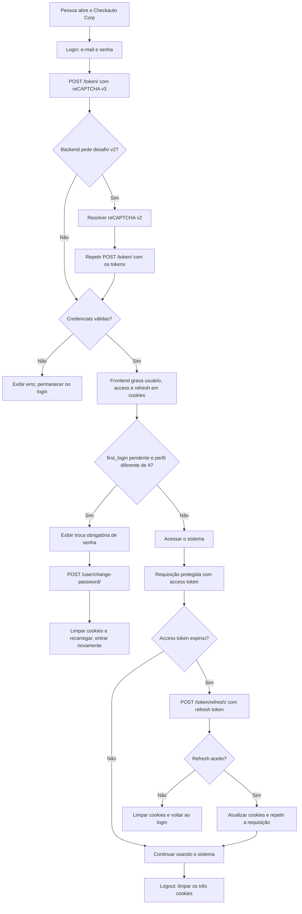
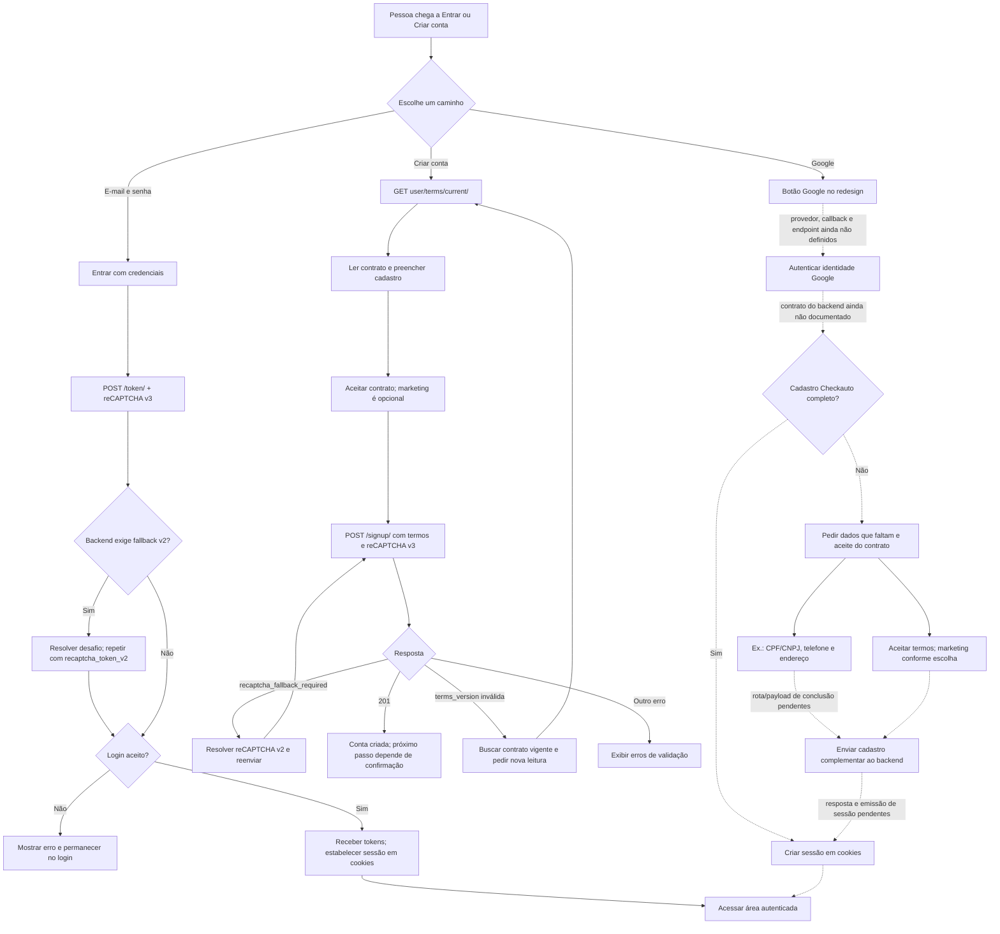

# Fluxo de autenticação — análise para o redesign

**Etapa 1: análise e diagrama.** Este documento não altera a implementação de
auth. Ele separa o comportamento observado no Checkauto CK-CORP do fluxo público
previsto para o redesign e destaca o que ainda precisa de confirmação. A
arquitetura e a implementação ficam para a etapa 2, após a avaliação do diagrama.

## 1. Fluxo atual no Checkauto CK-CORP

O CK-CORP tem login com e-mail e senha, reCAPTCHA, sessão com access/refresh
tokens guardados em cookies pelo frontend, renovação de sessão e troca de senha
no primeiro acesso para determinados perfis. Não encontrei login Google nem
cadastro público nesse projeto.

### O que o código atual confirma

- `AuthContext` chama `POST token/` e, no sucesso, grava `@Checkauto:user`,
  `@Checkauto:access` e `@Checkauto:refresh`. O helper usado é `universal-cookie`,
  portanto esses cookies são lidos e escritos pelo JavaScript; não são cookies
  `HttpOnly`.
- O cliente da API envia o access token nas chamadas protegidas. Em resposta
  `401`, tenta `POST /token/refresh/`, atualiza access/refresh e repete a
  chamada. Se a renovação falha, remove os cookies e redireciona para o login.
- A regra `mustChangePassword` exige troca quando `first_login` não é `"0"`,
  exceto para o perfil `"4"` (Usuário Web). A tela existente envia
  `current_password`, `new_password` e `new_password_again` para
  `user/change-password/`.
- A tela de login também oferece recuperação de senha por
  `user/forgot-password/`.
- Não encontrei fluxo de login Google ou de completar cadastro após login
  Google no CK-CORP.

## 2. Fluxo público previsto para o redesign

O fluxo abaixo combina o contrato de cadastro recebido em 24/11/2026 com os
endpoints documentados no Swagger. Linhas tracejadas indicam partes ainda sem
contrato confirmado. O diagrama não presume que o cadastro conclua uma sessão:
o contrato disponível só confirma a resposta `201`, sem especificar login
automático ou redirecionamento.

### Partes confirmadas para o site novo

- **Cadastro:** buscar o texto atual com `GET user/terms/current/`, mostrar o
  conteúdo como texto preservando espaços e recuos, e enviar
  `accept_terms: true`, a `terms_version` lida, `marketing_consent` e os campos
  do cadastro em `POST /signup/`.
- **reCAPTCHA:** o cadastro usa ação v3 `"signup"`; se o backend responder
  `recaptcha_fallback_required`, repetir com `recaptcha_token_v2`. O cadastro
  pelo Google não usa reCAPTCHA, conforme a especificação recebida.
- **Termos desatualizados:** se `terms_version` não for a vigente, buscar o
  contrato novamente e pedir que a pessoa leia e aceite a versão atual.
- **Tokens:** o login documentado usa `POST /token/`; a renovação usa
  `POST /token/refresh/`. A documentação do projeto espera access/refresh na
  resposta, mas registra que o Swagger repete o corpo da requisição como
  resposta e que o formato real ainda precisa ser confirmado.
- **Dados complementares do Google:** a especificação recebida prevê aceite do
  mesmo contrato e coleta dos dados que o Google não fornece, como CPF/CNPJ,
  telefone e endereço.

## 3. Pontos em aberto antes de implementar

1. **Google:** confirmar endpoints e payloads de autenticação, retorno do
   provedor, identificação de conta existente, criação de conta e associação de
   uma conta Google a uma conta já cadastrada.
2. **Cadastro incompleto:** confirmar como o backend informa que faltam dados,
   quais campos são obrigatórios por tipo de pessoa e qual endpoint salva o
   complemento. A especificação diz que os caminhos finais ainda serão
   confirmados.
3. **Cookies:** o código CK-CORP atual armazena tokens em cookies acessíveis ao
   JavaScript. O Swagger atual documenta tokens e autenticação por header, mas
   não descreve emissão ou renovação via `Set-Cookie`, atributos `HttpOnly`,
   `Secure`, `SameSite` ou escopo de domínio. Precisamos definir esse contrato
   com o backend antes de desenhar a sessão definitiva.
4. **Cadastro após sucesso:** confirmar se o `201` do cadastro público deve
   iniciar uma sessão, redirecionar ao login ou pedir alguma verificação
   adicional.
5. **Primeiro acesso no site público:** a regra observada no CK-CORP isenta o
   perfil Usuário Web (`"4"`) da troca obrigatória de senha. Confirmar se essa
   regra também se aplica às contas criadas pelo site e às contas Google.
6. **Swagger versus especificação:** a cópia do Swagger em
   `api/openapi.json` não lista `GET user/terms/current/` nem `POST /signup/`;
   lista `POST /user/signup/`, que é o cadastro administrativo do Corp. Para
   implementar o site novo, vale o contrato complementar
   `api/cadastro-aceite-contrato.md` até o Swagger ser atualizado.

## 4. Referências consultadas

- Checkauto CK-CORP local: `src/shared/contexts/auth-context.tsx`,
  `src/shared/lib/cookies.ts`, `src/shared/lib/api.ts`,
  `src/features/auth/utils/must-change-password.ts`,
  `src/pages/Login/index.tsx` e `src/routes/index.tsx`.
- Swagger copiado em `api/openapi.json` e resumo em `api/README.md`.
- Especificação de aceite do contrato recebida em 24/11/2026:
  `api/cadastro-aceite-contrato.md`.
- Estado atual do redesign: a sessão está em `app/shared/lib/session.ts` e o
  botão Google em `app/features/auth/components/social-sign-in.tsx` ainda é
  apenas visual, sem ação.
