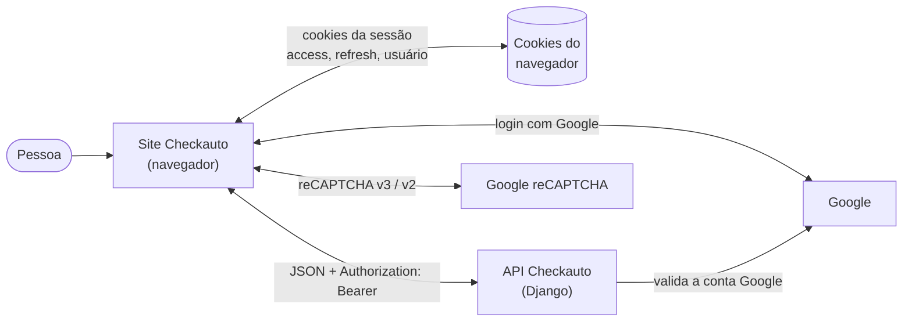
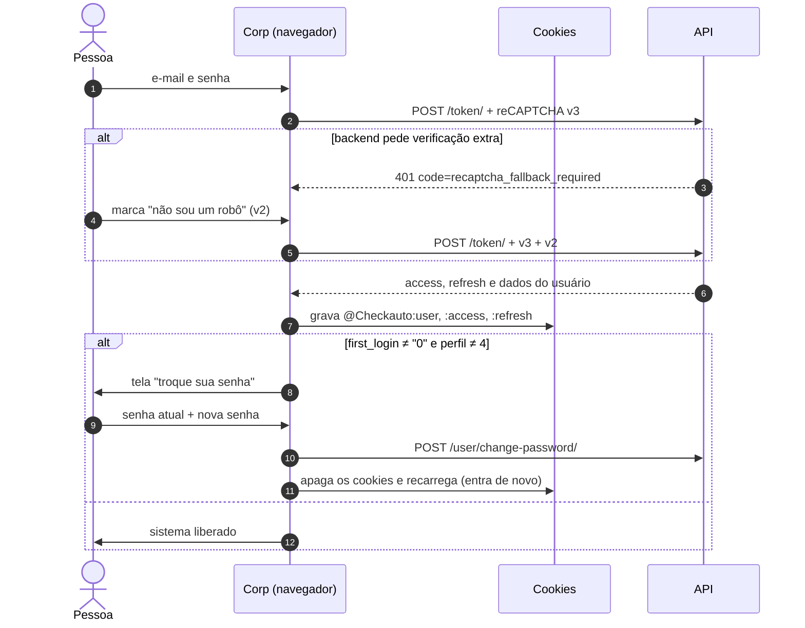
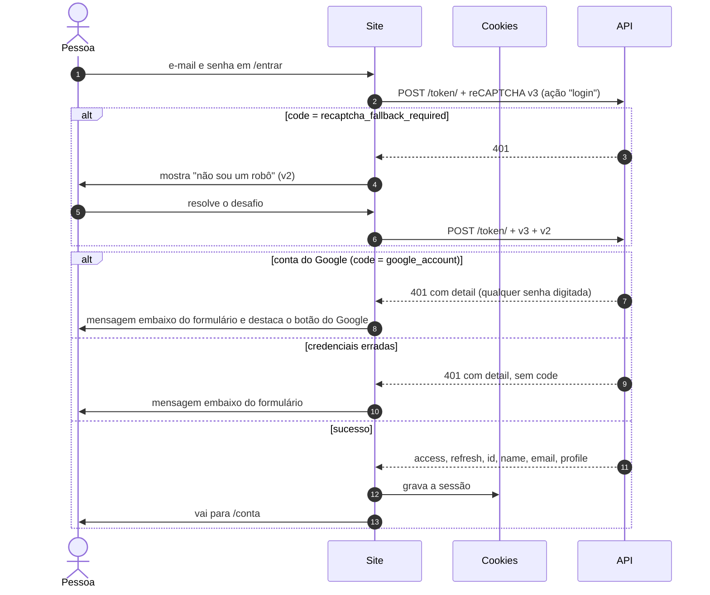
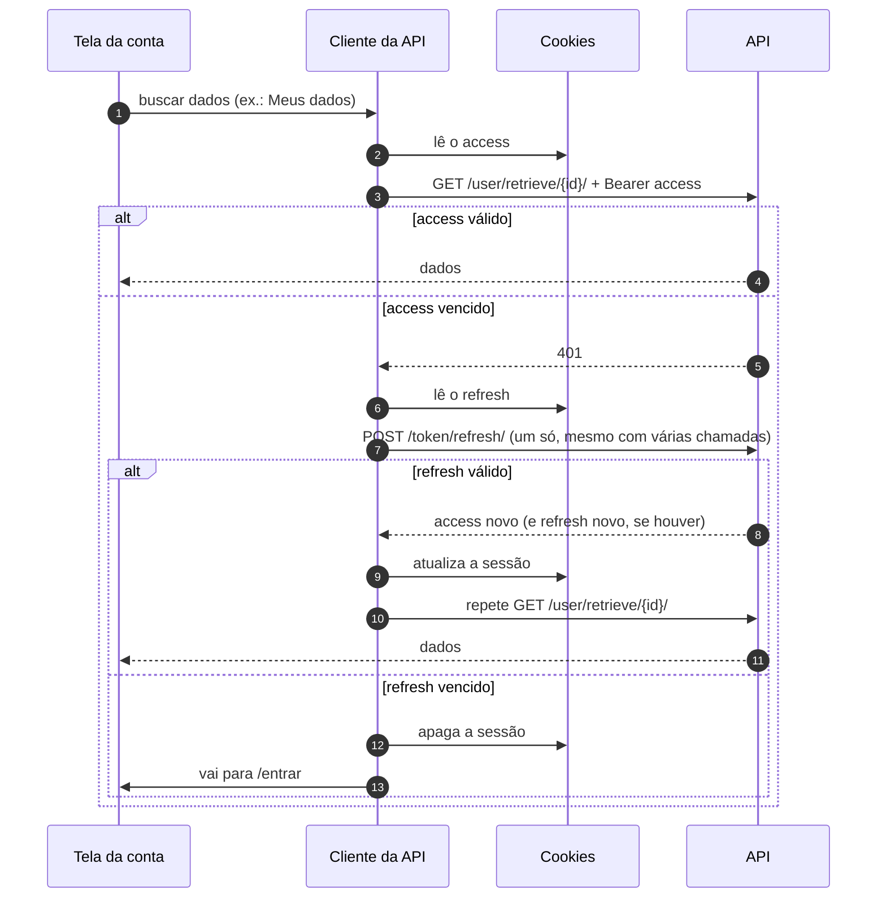
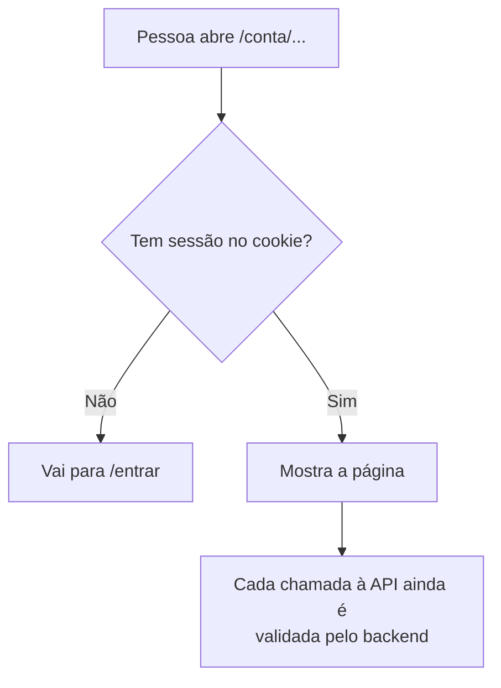
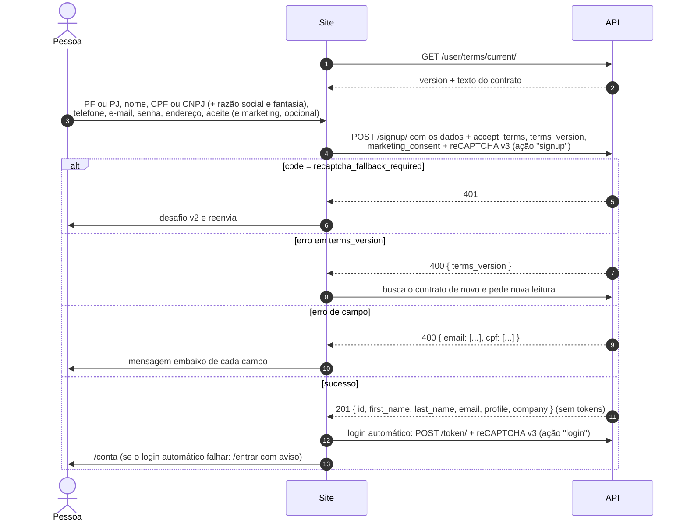
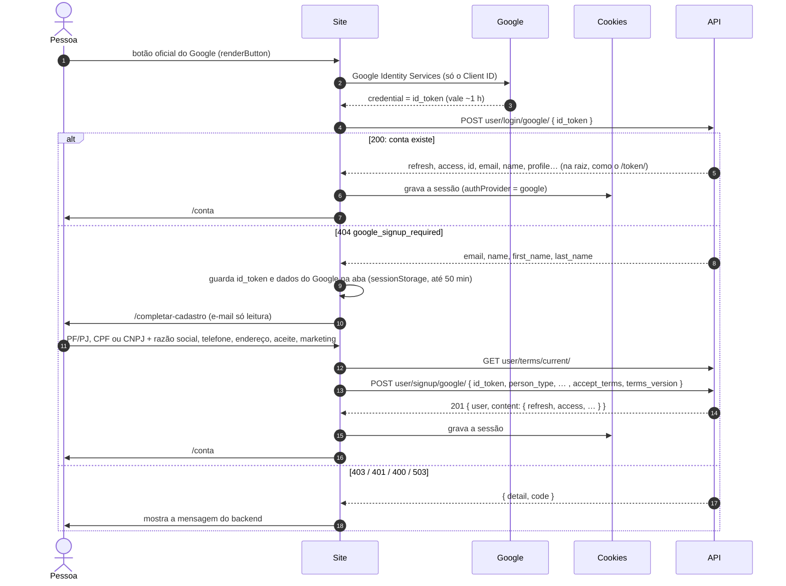
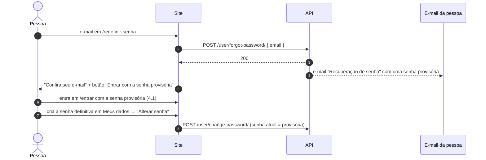
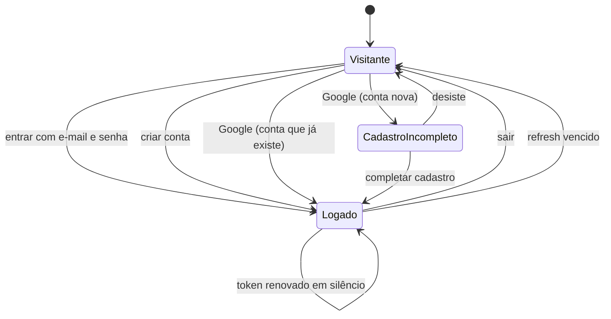
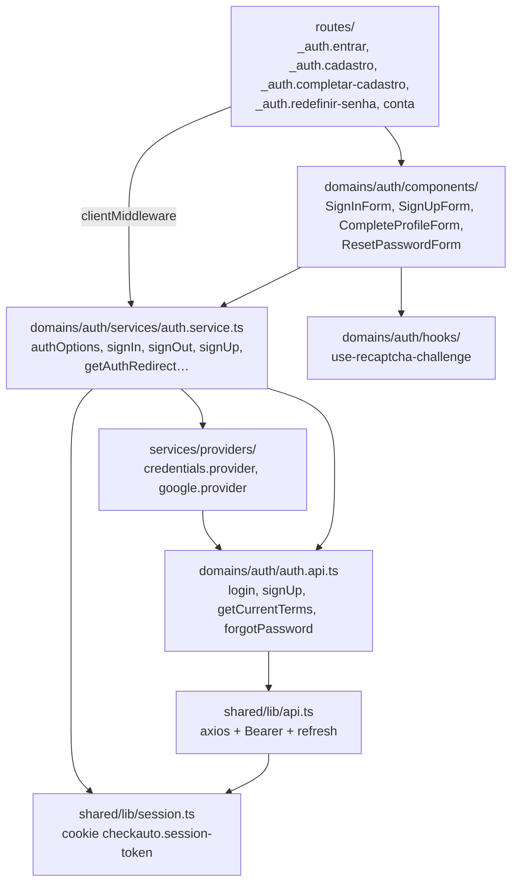

# Fluxo de autenticação

Como o login funciona no **Checkauto Corp** e no **site novo**: entrar com e-mail e senha, sessão em cookies, cadastro, login com Google, completar cadastro, esqueci a senha e primeiro acesso.

Os diagramas usam [Mermaid](https://mermaid.js.org/) e aparecem desenhados no GitHub e no VS Code (com a extensão de preview de Markdown com Mermaid).

**Legenda**

- ✅ confirmado pelo Swagger (`docs/api/openapi.json`) ou pela especificação do backend (`docs/api/cadastro-aceite-contrato.md`).
- ⏳ ainda depende do backend. Nos diagramas, as setas tracejadas (`-->>` com "⏳") são esses passos.

## 1. As peças

- **Site:** é estático (sem servidor próprio). Tudo acontece no navegador, que chama a API diretamente.
- **Cookie:** um só (`checkauto.session-token`) guarda a sessão (access token, refresh token e dados básicos do usuário). Como quem grava é o JavaScript do site, **não** são `HttpOnly`; o mesmo modelo do Corp.
- **API:** autentica por JWT. Toda rota protegida recebe `Authorization: Bearer <access>`.
- **Tokens:** o `access` abre as rotas protegidas; o `refresh` serve só para pedir um `access` novo quando ele vence.

## 2. Rotas de auth do backend

| Fluxo               | Rota                                                                                     | Token? | Situação                                                |
| ------------------- | ---------------------------------------------------------------------------------------- | ------ | ------------------------------------------------------- |
| Login               | `POST /token/` (`username`, `password`, `recaptcha_token`, `recaptcha_token_v2`)         | não    | ✅                                                      |
| Renovar sessão      | `POST /token/refresh/` (`refresh`)                                                       | não    | ✅                                                      |
| Validar token       | `POST /token/verify/` (`token`)                                                          | não    | ✅ (não precisamos usar)                                |
| Texto do contrato   | `GET /user/terms/current/`                                                               | não    | ✅                                                      |
| Cadastro do site    | `POST /signup/`                                                                          | não    | ✅ corpo completo em `cadastro-aceite-contrato.md` (A6) |
| Esqueci a senha     | `POST /user/forgot-password/` (`email`)                                                  | não    | ✅ envia e-mail com senha provisória                    |
| Trocar senha        | `POST /user/change-password/` (`current_password`, `new_password`, `new_password_again`) | sim    | ✅ (formato usado pelo Corp)                            |
| Meus dados          | `GET /user/retrieve/{id}/`, `PUT /user/update/{id}/`                                     | sim    | ✅                                                      |
| Login com Google    | `POST /user/login/google/` (`id_token`)                                                  | não    | ✅ contrato do backend (fora do Swagger)                |
| Cadastro com Google | `POST /user/signup/google/` (`id_token`, PF/PJ, endereço, aceite)                        | não    | ✅ contrato do backend (fora do Swagger)                |

Resposta do login (`POST /token/`): `access`, `refresh`, `id`, `name`, `email`, `profile`, `first_login`, `corporate_id`, `corporate_name`, `checkmatch`, `checkmatch_token`. Erros vêm como `{ "detail": "...", "code": "..." }`.

## 3. Como o Corp faz hoje

- **Sessão:** três cookies gravados pelo JavaScript (`universal-cookie`). A pessoa está "logada" se o cookie do usuário existe.
- **Chamadas:** um interceptor do axios põe `Authorization: Bearer <access>` em tudo.
- **Token vencido:** no `401`, faz **um** `POST /token/refresh/` (as outras chamadas esperam numa fila), regrava os cookies e repete a chamada. Se o refresh falha, apaga os cookies e volta ao login.
- **Primeiro acesso:** só para perfis internos. O **perfil 4 (cliente do site) não passa por isso**.
- **Esqueci a senha:** `POST /user/forgot-password/` com `{ email }`; o backend responde com uma mensagem e manda o e-mail.
- **Não existe** no Corp: cadastro público, login com Google, completar cadastro.

## 4. Como funciona no site

### 4.1 Entrar com e-mail e senha

- **Conta do Google no login por senha** (backend, 27/11/2026): se o e-mail for de uma conta criada ou vinculada ao Google, o `POST /token/` responde `401` com `{ detail, code: "google_account" }`, qualquer que seja a senha. O site mostra o `detail` embaixo do formulário, destaca o botão do Google (anel verde) e rola a tela até ele.
- **Senha errada em conta normal:** continua `401` com `"Usuário e/ou senha incorreto(s)"`, **sem** `code`.
- **Ordem das checagens:** o reCAPTCHA vem antes. Sem token válido, o erro é o do reCAPTCHA, não o `google_account`.

### 4.2 Sessão, chamadas e saída

- **Sair:** apaga os cookies e volta para a home. ⏳ Não há rota de logout no backend, então o refresh continua válido até vencer.
- **Várias abas:** todas leem os mesmos cookies; sair numa aba vale para as outras na próxima ação.
- **Header do site:** com sessão, mostra o avatar (link para a conta); sem sessão, o botão "Entrar".

### 4.3 Proteção da área da conta

O caminho inverso também vale: quem já está logado e abre `/entrar` ou `/cadastro` vai direto para `/conta`. Quem entra pelo Google sem cadastro só ganha sessão depois de concluir o `/completar-cadastro` (4.5).

A proteção no navegador só decide **qual tela mostrar**. Quem protege os dados de verdade é o backend, que exige o token em cada rota.

### 4.4 Criar conta (e-mail e senha)

- Cadastro **não** manda `Authorization`, mesmo com sessão aberta.
- **Tela:** o aceite é uma linha só, "Li e aceito o contrato vigente (versão)". O trecho "contrato vigente" abre o texto num painel de baixo para cima (`Sheet`), com o botão "Li e aceito". A política de privacidade fica no rodapé da tela (`components/auth-footer.tsx`) e abre em outra aba, para não apagar o formulário preenchido.
- **Campos (contrato recebido do backend em 26/11/2026, em `docs/api/cadastro-aceite-contrato.md`, parte A6):** a pessoa escolhe **PF** (CPF) ou **PJ** (CNPJ, razão social e nome fantasia), como no "Usuário Web" do Corp. Telefone e endereço são obrigatórios. O `201` não traz tokens, então o site entra em seguida pelo `POST /token/`.
- **Tela em 3 etapas** (`components/sign-up-form.tsx` + `hooks/use-form-steps.ts`): **1. Acesso** (e-mail e senha; o botão do Google aparece só aqui), **2. Seus dados** (PF ou PJ, nome, CPF ou CNPJ, telefone) e **3. Endereço** (endereço, aceite do contrato, marketing e "Criar conta"). "Continuar" valida só os campos da etapa; "Voltar" mantém o que já foi preenchido. Nada vai para o backend antes da última etapa, que envia o corpo completo num único `POST /signup/`. Se o backend devolver erro num campo de outra etapa, a tela volta para ela.
- **CEP:** ao completar os 8 dígitos, o site consulta o ViaCEP (`https://viacep.com.br/ws/<cep>/json/`, em `shared/lib/zip-lookup.ts`) e preenche rua, bairro, cidade e UF; o foco vai para "Número". CEP inexistente mostra "CEP não encontrado."; se o serviço falhar, a pessoa preenche à mão. Vale para `/cadastro` e `/completar-cadastro`. É uma chamada a um serviço externo, fora da API da Checkauto.
- **UF:** usa o `Select` do shadcn (`shared/components/ui/select.tsx`), não o `<select>` nativo.
- **Senha:** 8 a 16 caracteres, com maiúscula, minúscula, número e um símbolo entre `_ @ ! ( ) & + $`, sem espaços. A mesma regra vale em "Alterar senha".
- Os campos de pessoa e de endereço são os mesmos do `/completar-cadastro` (`components/profile-fields.tsx`), e os dois formulários montam o corpo pela mesma função (`profileBody` em `auth.service.ts`).

**Corpo enviado: Corp × site** (o do site é travado pelo teste `services/auth.service.sign-up.test.ts`)

| Campo                                                           | Corp (`POST user/signup/`, admin)       | Site (`POST /signup/`, público)              |
| --------------------------------------------------------------- | --------------------------------------- | -------------------------------------------- |
| `person_type`                                                   | `pf` ou `pj`                            | `pf` ou `pj`                                 |
| `first_name`, `last_name`, `email`, `password`                  | sim                                     | sim                                          |
| `cpf`                                                           | PF, só dígitos                          | PF, só dígitos                               |
| `cnpj`, `corporate_name`, `fantasy_name`                        | PJ                                      | PJ (CNPJ só dígitos)                         |
| `business_area`, `state_registration`, `municipal_registration` | PJ                                      | **não envia** (opcionais; sem campo na tela) |
| `phone`                                                         | sim, só dígitos                         | sim, só dígitos                              |
| `cep`, `street`, `number_address`, `district`, `city`, `uf`     | sim                                     | sim (`cep` só dígitos)                       |
| `complement`                                                    | sim                                     | só quando preenchido                         |
| `accept_terms`, `terms_version`, `marketing_consent`            | **não envia** (ajuste pendente no Corp) | sim                                          |
| `recaptcha_token` (+ `recaptcha_token_v2` quando pedido)        | não se aplica                           | sim                                          |

### 4.5 Entrar com Google e completar o cadastro

Contrato recebido do backend (fora do Swagger): `POST user/login/google/` e `POST user/signup/google/`, ambos públicos e sem reCAPTCHA.

- **Quem entra pelo Google ainda preenche os dados restantes:** conta Google sem cadastro vai para `/completar-cadastro`, em 2 etapas (**1. Seus dados**, **2. Endereço** com o aceite), com os mesmos campos do cadastro por senha.
- **Sem senha:** o corpo do `POST user/signup/google/` leva o `id_token` e os dados, **sem `email` e sem `password`** (travado pelo teste `services/auth.service.sign-up.test.ts`).
- ⏳ **Definir senha depois, no perfil:** a ideia é a pessoa que entrou pelo Google poder criar uma senha em Meus dados. Hoje "Alterar senha" fica escondido para conta Google, e o backend não tem rota para criar a primeira senha (`change-password` exige a senha atual).

- **Erros do login:**
  - `google_link_not_allowed`: o e-mail já tem cadastro com senha, então a pessoa deve entrar com e-mail e senha;
  - `google_account_mismatch`;
  - `google_profile_not_allowed`;
  - `user_blocked` e `contract_expired`;
  - `google_token_invalid` e `google_email_not_verified`;
  - `google_not_configured` e `google_unavailable`.
  - Em todos, o site mostra o `detail` do backend.
- **Erros do cadastro (`signup/google`):**
  - erros de campo aparecem no campo certo;
  - `google_already_registered` volta para `/entrar`;
  - `google_token_invalid` e `google_email_not_verified` pedem o Google de novo;
  - nos três casos, o cadastro pendente é limpo.
- **Conta do Google não tem senha:** "Alterar senha" some em Meus dados.
  - **Login por senha:** o `POST /token/` responde `401` com `code: "google_account"` (ver 4.1).
  - **Esqueci a senha:** o `POST /user/forgot-password/` responde `400` com `content = { message, code: "google_account" }`, com a mesma frase do login. O site mostra a frase do backend e um link "Entrar com o Google" para `/entrar`.
- **Foto de perfil:** o `id_token` do Google traz o endereço da foto (`picture`). O site lê esse campo no navegador (`readGooglePicture`), guarda na sessão (`user.picture`) e mostra no avatar da conta e do header; sem foto, ou se a imagem falhar, fica o ícone padrão. Não passa pelo backend, vale só para quem entra pelo Google e é lida de novo a cada login. O token não é validado para isso, porque é só exibição; quem valida continua sendo o backend.
- **Chave do Google:** o site usa só o **Client ID** (`VITE_GOOGLE_CLIENT_ID`). O secret fica no backend.
- **Cliente HTTP:** `user/login/google/` e `user/signup/google/` estão fora do interceptor de 401, porque `user_blocked` também volta como 401.

### 4.6 Esqueci a senha

- ✅ **Confirmado em teste real (26/11/2026):** a rota envia o e-mail de verdade, e ele traz uma **senha provisória** (não é link nem código). É o mesmo esquema do Corp.
- **Tela de sucesso:** explica a senha provisória, leva para `/entrar` com o e-mail preenchido e tem "Reenviar e-mail", que chama a rota de novo e avisa por toast.
- **Troca da senha provisória:** hoje é manual, em Meus dados → "Alterar senha". O Corp obriga a troca quando o login devolve `first_login ≠ "0"`, mas isenta o perfil 4. ⏳ Perguntar ao backend se, depois do "esqueci a senha", o login do cliente do site sinaliza a senha provisória; se sim, o site pode obrigar a troca logo após entrar.
- **Problemas no e-mail (são do backend):** o link "Fazer login" sai quebrado, como `[/login]Fazer login`, sem endereço; o logo é o antigo; e a senha provisória vai em texto puro.
- **E-mail sem conta:** `POST /user/forgot-password/` respondeu `400` com `{ content: { message: "Opss.. Por favor tente novamente mais tarde!" } }`, e o site mostra essa mensagem como erro. Isso revela quais e-mails têm conta; confirmar com o backend se é o esperado.

### 4.7 Primeiro acesso de cliente migrado

Não implementado. A especificação do backend cita, "se aprovada", um código `password_setup_required` no login e um `POST /user/password/set/`; em 26/11/2026 essa rota respondia `404`. O site chegou a ter uma tela `/definir-senha` para isso e uma `/nova-senha` (que supunha um link com token no "esqueci a senha"); as duas foram **removidas em 26/11/2026** por não terem uso. Se o backend criar a rota, a tela volta a partir desta descrição.

### 4.8 Estados da pessoa no site

## 5. Corp × site

| Assunto            | Corp                                      | Site                                                           |
| ------------------ | ----------------------------------------- | -------------------------------------------------------------- |
| Quem usa           | equipe e empresas (perfis internos)       | cliente final (perfil 4)                                       |
| Sessão             | 3 cookies via JavaScript                  | 1 cookie via JavaScript (mesmo modelo)                         |
| Login              | e-mail e senha + reCAPTCHA v3/v2          | igual, mais Google                                             |
| Cadastro           | feito pela equipe (`user/signup/`, admin) | a própria pessoa (`/signup/`, público, com reCAPTCHA e aceite) |
| Primeiro acesso    | troca de senha obrigatória                | não se aplica                                                  |
| Completar cadastro | não existe                                | depois do Google                                               |
| Token vencido      | refresh automático; falhou → login        | igual                                                          |

## 6. Perguntas para o backend

1. **Google:** contrato recebido. Falta só testar de ponta a ponta quando o ambiente voltar.
2. **Cadastro incompleto:** resolvido pelo fluxo do Google (`google_signup_required` → `/completar-cadastro`). Não há `profile_complete`.
3. **`/signup/`:** ✅ respondido em 26/11/2026: PF ou PJ, telefone e endereço obrigatórios, `201` sem tokens (ver 4.4).
4. **Esqueci a senha:** ✅ respondido em 26/11/2026: o e-mail traz senha provisória. Em aberto: o login sinaliza a senha provisória para o perfil 4 (para obrigar a troca)? O link "Fazer login" do e-mail está quebrado. E-mail sem conta deve responder erro (`400`, como hoje) ou sucesso genérico?
5. **Migrados:** o `password_setup_required` e o `POST /user/password/set/` vão existir? Qual o corpo? Hoje a rota responde `404` e o site não tem tela para isso.
6. **Logout:** vai existir rota para invalidar o refresh (blacklist)?
7. **Senha para conta Google:** qual rota cria a primeira senha de quem se cadastrou pelo Google (sem senha atual)?
8. **Duração dos tokens:** hoje `access` e `refresh` duram 24 h cada e vencem juntos (medido em 26/11/2026), então a renovação não serve para nada e a pessoa é deslogada todo dia. Dá para encurtar o `access` (por exemplo 15 min) e alongar o `refresh` (dias ou semanas)?
9. **Cookies `HttpOnly` (futuro):** o backend pode passar a gravar o refresh num cookie `HttpOnly`? Hoje fica com o JavaScript, igual ao Corp.
10. **CORS:** liberar `http://localhost:3000` e os domínios de preview e produção do site. Em 26/11/2026 o `localhost:3000` está liberado; o domínio da Vercel não.

## 7. Arquitetura no código

O auth fica em `app/domains/auth`, em camadas. Cada camada só chama as de baixo. As regras de import são checadas pelo Biome.

| next-auth                                             | aqui                                                    |
| ----------------------------------------------------- | ------------------------------------------------------- |
| `auth.ts` / `authOptions`                             | `domains/auth/services/auth.service.ts`                 |
| `providers/credentials`, `providers/google`           | `domains/auth/services/providers/*.provider.ts`         |
| `callbacks.session`, `pages.signIn` / `pages.newUser` | `authOptions.callbacks` / `authOptions.pages`           |
| cookie `next-auth.session-token`                      | `checkauto.session-token` (`__Secure-` em https)        |
| `useSession()` / `getSession()`                       | `shared/hooks/use-session.ts` / `shared/lib/session.ts` |
| `middleware.ts`                                       | `clientMiddleware` da rota + `getAuthRedirect`          |

**Decisões:**

- **`auth.api.ts` × `auth.service.ts`:** o `auth.api.ts` só fala HTTP (endpoint e validação da resposta). O `auth.service.ts` tem a regra: provider, reCAPTCHA, a sessão e para onde redirecionar.
- **Rotas de visitante e protegidas:** `/entrar` e `/cadastro` redirecionam quem já está logado na própria rota (`useSession` + `<Navigate>`), para continuar pré-renderizadas com o formulário. `/conta` e `/completar-cadastro` usam `clientMiddleware`, e o HTML pré-renderizado delas mostra só "Carregando…".
- **Cadastro pelo Google:** `/completar-cadastro` só abre com um cadastro do Google pendente na aba; sem ele, vai para `/entrar` (ou `/conta`, se já tiver sessão).
- **Layout das telas de auth (`routes/_auth.tsx`):** arte num painel arredondado à esquerda (`components/auth-showcase.tsx`, com a ilustração `assets/auth-showcase.svg`) e formulário à direita. A arte só aparece a partir de `lg`; no mobile fica só a logo. Em 26/11/2026 foram testados e descartados: só a logo com o formulário centralizado, a arte em faixa colada na borda direita e uma foto de veículo no lugar da ilustração.
- **Login social primeiro:** em `/entrar` e `/cadastro` o botão do Google vem antes do formulário, seguido de "ou".
- **Alterar senha (Meus dados):** depois do `POST /user/change-password/` o diálogo fecha, a pessoa **continua logada** e vê o toast "Senha alterada"; a senha nova vale no próximo login. (O Corp desloga depois da troca; o site não.) Se o backend passar a invalidar os tokens na troca, a sessão cai sozinha no próximo `401` e a pessoa volta para `/entrar`.
- **`authProvider` na sessão:** `credentials` ou `google`, para esconder "Alterar senha" de quem entra pelo Google.

## 8. Referências

- Corp: `src/shared/contexts/auth-context.tsx`, `src/shared/lib/api.ts`, `src/shared/lib/cookies.ts`, `src/features/auth/utils/must-change-password.ts`, `src/pages/Login/index.tsx`, `src/routes/index.tsx`.
- Swagger: `docs/api/openapi.json` (cópia de 26/11/2026, 139 rotas: entraram `user/login/google/` e `user/signup/google/`) e o resumo em `docs/api/README.md`.
- Especificação do cadastro: `docs/api/cadastro-aceite-contrato.md`.

## 9. O que já foi testado

Rodada de 26/11/2026, com o site em `localhost:3000` e o backend no túnel ngrok de desenvolvimento.

| Item                                                                    | Resultado                                                                                                                                 |
| ----------------------------------------------------------------------- | ----------------------------------------------------------------------------------------------------------------------------------------- |
| `/conta` sem sessão                                                     | ✅ vai para `/entrar`                                                                                                                     |
| `/entrar` e `/cadastro` com sessão                                      | ✅ vão para `/conta/consultas`                                                                                                            |
| `/completar-cadastro` sem cadastro do Google pendente                   | ✅ vai para `/entrar`                                                                                                                     |
| Validação de `/entrar`, `/cadastro` e `/redefinir-senha`                | ✅ envio vazio mostra os erros e foca o primeiro campo                                                                                    |
| Contrato no cadastro                                                    | ✅ carrega a versão `2026-11` da API; o link "contrato vigente" abre o texto num painel que sobe de baixo, e "Li e aceito" marca o aceite |
| Botão do Google em `/entrar` e `/cadastro`                              | ✅ script e botão carregam                                                                                                                |
| Etapas do cadastro (1 e 2: validação por etapa, voltar mantém os dados) | ✅ no navegador, sem enviar ao backend                                                                                                    |
| Corpo do `POST /signup/` (PF e PJ)                                      | ✅ teste automático (`auth.service.sign-up.test.ts`)                                                                                      |
| `POST /user/forgot-password/` com e-mail sem conta                      | ⚠️ `400` com mensagem de erro (ver 4.6)                                                                                                   |

### Testes manuais de ponta a ponta (dono do projeto, 26/11/2026)

Feitos no navegador, em `localhost:3000`, contra o backend do túnel de desenvolvimento.

| Fluxo                                                                              | Resultado                                                                                                                                                                        |
| ---------------------------------------------------------------------------------- | -------------------------------------------------------------------------------------------------------------------------------------------------------------------------------- |
| Cadastro de PF por e-mail e senha                                                  | ✅ o `POST /signup/` saiu com todos os campos do contrato e o backend respondeu `201` com `id`, `first_name`, `last_name`, `email`, `profile: "4"` e `company: null`, sem tokens |
| Cadastro de PJ por e-mail e senha                                                  | ✅                                                                                                                                                                               |
| Login automático depois do cadastro                                                | ✅                                                                                                                                                                               |
| Erro do backend em campo de outra etapa (e-mail, CPF ou CNPJ já usado)             | ✅ a tela volta para a etapa do campo                                                                                                                                            |
| Login com senha certa e com senha errada                                           | ✅                                                                                                                                                                               |
| Sair                                                                               | ✅                                                                                                                                                                               |
| Login e cadastro com Google, até o fim de `/completar-cadastro`                    | ✅                                                                                                                                                                               |
| Entrar pelo Google com e-mail que já tem senha (`google_link_not_allowed`)         | ✅ mostra a mensagem do backend                                                                                                                                                  |
| Esqueci a senha: envio do e-mail                                                   | ✅ chega com a senha provisória                                                                                                                                                  |
| Esqueci a senha com conta Google (`google_account`)                                | ✅                                                                                                                                                                               |
| Login por senha com conta Google (`google_account` no `/token/`, desde 27/11/2026) | ⏳ ainda não testado                                                                                                                                                             |
| "Reenviar e-mail"                                                                  | ✅                                                                                                                                                                               |
| Entrar com a senha provisória e trocá-la em Meus dados                             | ✅                                                                                                                                                                               |
| Alterar senha em Meus dados                                                        | ✅ continua logado e mostra o toast                                                                                                                                              |
| Renovação do token                                                                 | ✅ com o `access` invalidado à mão no cookie: `GET /user/retrieve/…` → `401`, `POST /token/refresh/` → `200`, o mesmo `GET` → `200`; a tela carregou e a sessão continuou        |

**Duração dos tokens, medida em 26/11/2026:** o `access` dura **24 h** (1440 min) e o `refresh` também dura **24 h**. Como os dois são emitidos juntos e vencem juntos, a renovação nunca acontece no uso real: quando o `access` vence, o `refresh` já venceu, e a pessoa volta para `/entrar` um dia depois do login. O mecanismo do site funciona (linha acima), mas só foi exercitado com o token invalidado de propósito.

**Ainda sem teste:**

- o desafio "não sou um robô" (reCAPTCHA v2) no login e no cadastro, que só aparece quando o backend pede a verificação extra;
- os mesmos fluxos no endereço da Vercel, depois de um deploy apontando para um backend com as rotas novas.
