# Fluxo de autenticação

Como o login funciona hoje no **Checkauto Corp** e como vai funcionar no **site novo**: entrar com e-mail e senha, sessão em cookies, cadastro, login com Google, completar cadastro, esqueci a senha e primeiro acesso.

Os diagramas usam [Mermaid](https://mermaid.js.org/) e aparecem desenhados no GitHub e no VS Code (com a extensão de preview de Markdown com Mermaid).

**Legenda**

- ✅ confirmado pelo Swagger (`docs/api/openapi.json`) ou pela especificação do backend (`docs/api/cadastro-aceite-contrato.md`).
- ⏳ ainda depende do backend. Nos diagramas, as setas tracejadas (`-->>` com "⏳") são esses passos.

## 1. As peças

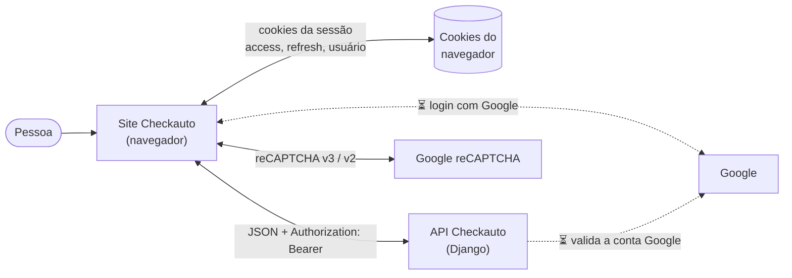

- **Site:** é estático (sem servidor próprio). Tudo acontece no navegador, que chama a API diretamente.
- **Cookies:** guardam a sessão (access token, refresh token e dados básicos do usuário). Como quem grava é o JavaScript do site, **não** são `HttpOnly`; o mesmo modelo do Corp.
- **API:** autentica por JWT. Toda rota protegida recebe `Authorization: Bearer <access>`.
- **Tokens:** o `access` abre as rotas protegidas; o `refresh` serve só para pedir um `access` novo quando ele vence.

## 2. Rotas de auth do backend

| Fluxo                    | Rota                                                                                     | Token? | Situação                                                            |
| ------------------------ | ---------------------------------------------------------------------------------------- | ------ | ------------------------------------------------------------------- |
| Login                    | `POST /token/` (`username`, `password`, `recaptcha_token`, `recaptcha_token_v2`)         | não    | ✅                                                                  |
| Renovar sessão           | `POST /token/refresh/` (`refresh`)                                                       | não    | ✅                                                                  |
| Validar token            | `POST /token/verify/` (`token`)                                                          | não    | ✅ (não precisamos usar)                                            |
| Texto do contrato        | `GET /user/terms/current/`                                                               | não    | ✅                                                                  |
| Cadastro do site         | `POST /signup/`                                                                          | não    | ✅ rota; ⏳ corpo completo                                          |
| Esqueci a senha          | `POST /user/forgot-password/` (`email`)                                                  | não    | ✅ rota; ⏳ o que vem depois do e-mail                              |
| Trocar senha             | `POST /user/change-password/` (`current_password`, `new_password`, `new_password_again`) | sim    | ✅ (formato usado pelo Corp)                                        |
| Meus dados               | `GET /user/retrieve/{id}/`, `PUT /user/update/{id}/`                                     | sim    | ✅                                                                  |
| Login com Google         | `POST /user/login/google/` (`id_token`)                                                  | não    | ✅ contrato do backend (fora do Swagger)                            |
| Cadastro com Google      | `POST /user/signup/google/` (`id_token`, PF/PJ, endereço, aceite)                        | não    | ✅ contrato do backend (fora do Swagger)                            |
| Definir senha (migrados) | `POST /user/password/set/`                                                               | —      | ⏳ só na especificação, "se aprovada"; em 26/11/2026 responde `404` |
| Criar senha nova (link)  | `POST /user/password/reset/` (`token`, `password`)                                       | não    | ⏳ rota e corpo **supostos pelo site**; não existe no backend       |

Resposta do login (`POST /token/`): `access`, `refresh`, `id`, `name`, `email`, `profile`, `first_login`, `corporate_id`, `corporate_name`, `checkmatch`, `checkmatch_token`. Erros vêm como `{ "detail": "...", "code": "..." }`.

## 3. Como o Corp faz hoje

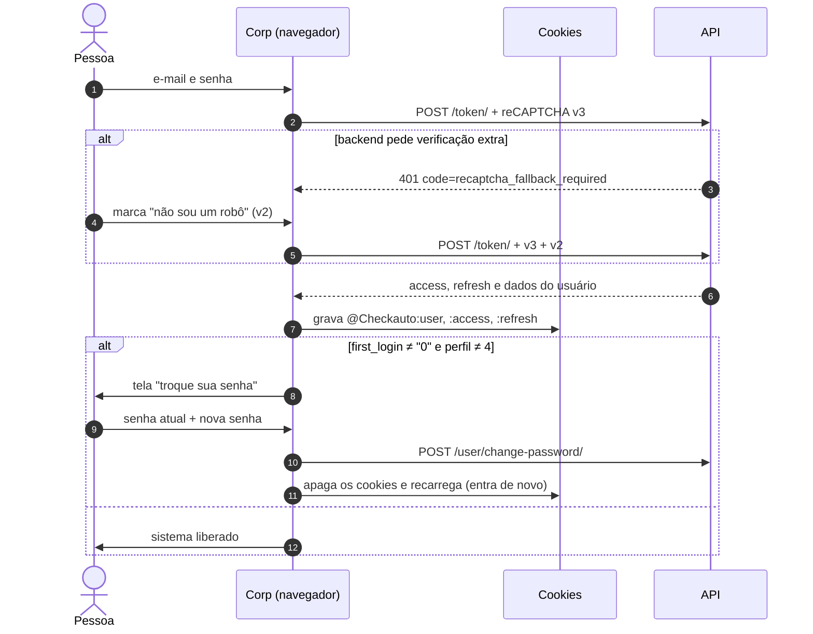

- **Sessão:** três cookies gravados pelo JavaScript (`universal-cookie`). A pessoa está "logada" se o cookie do usuário existe.
- **Chamadas:** um interceptor do axios põe `Authorization: Bearer <access>` em tudo.
- **Token vencido:** no `401`, faz **um** `POST /token/refresh/` (as outras chamadas esperam numa fila), regrava os cookies e repete a chamada. Se o refresh falha, apaga os cookies e volta ao login.
- **Primeiro acesso:** só para perfis internos. O **perfil 4 (cliente do site) não passa por isso**.
- **Esqueci a senha:** `POST /user/forgot-password/` com `{ email }`; o backend responde com uma mensagem e manda o e-mail.
- **Não existe** no Corp: cadastro público, login com Google, completar cadastro.

## 4. Como vai funcionar no site

### 4.1 Entrar com e-mail e senha

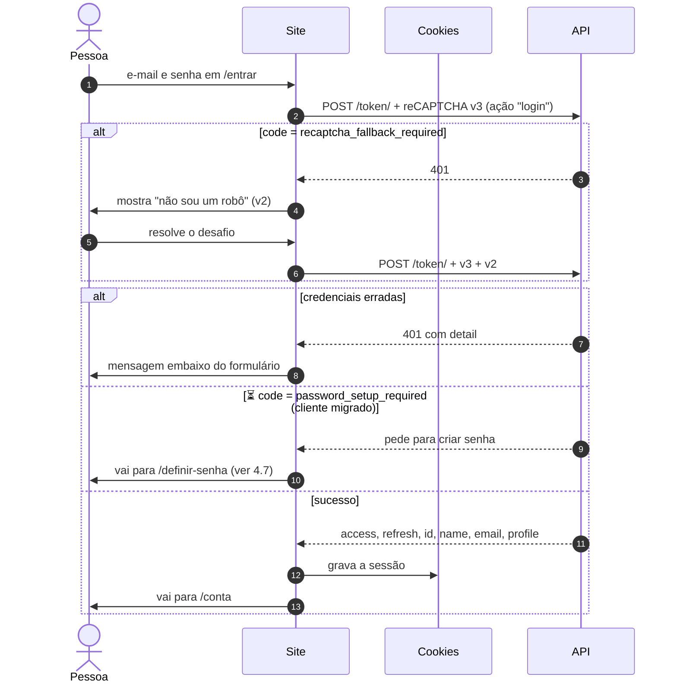

### 4.2 Sessão, chamadas e saída

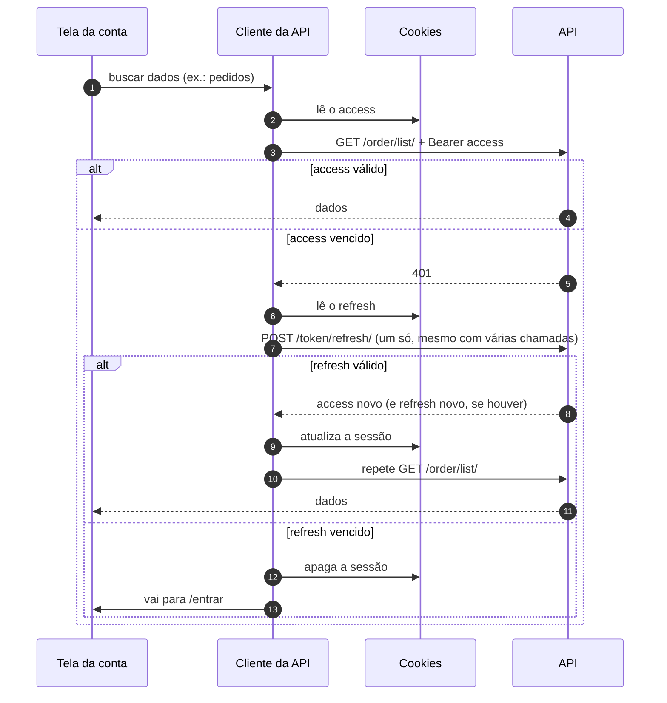

- **Sair:** apaga os cookies e volta para a home. ⏳ Não há rota de logout no backend, então o refresh continua válido até vencer.
- **Várias abas:** todas leem os mesmos cookies; sair numa aba vale para as outras na próxima ação.
- **Header do site:** com sessão, mostra o avatar (link para a conta); sem sessão, o botão "Entrar".

### 4.3 Proteção da área da conta

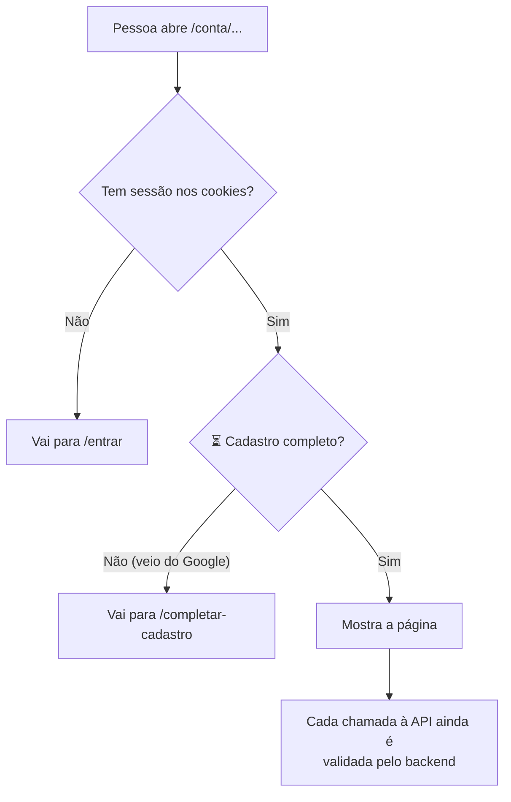

A proteção no navegador só decide **qual tela mostrar**. Quem protege os dados de verdade é o backend, que exige o token em cada rota.

### 4.4 Criar conta (e-mail e senha)

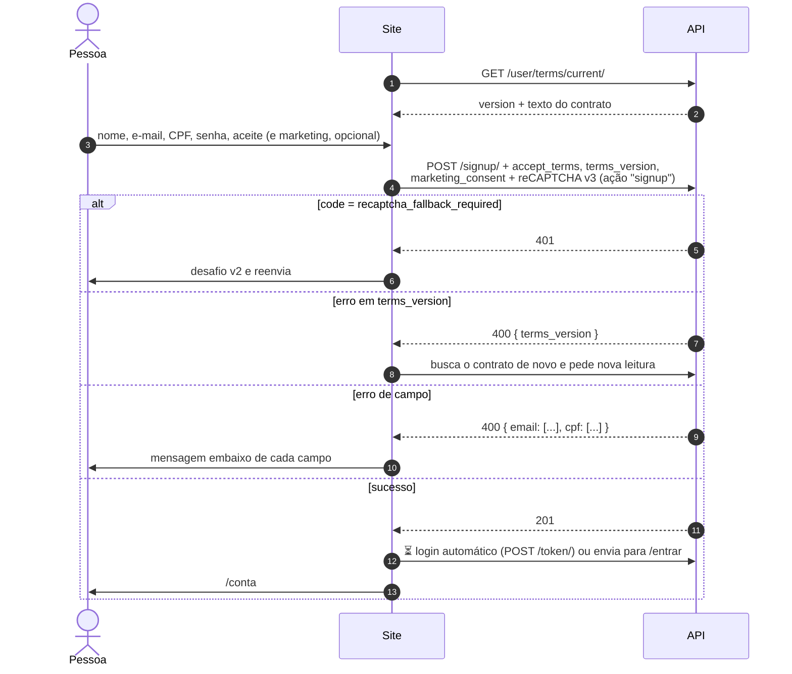

- Cadastro **não** manda `Authorization`, mesmo com sessão aberta.
- ⏳ Falta o backend confirmar os campos obrigatórios do `/signup/`. O Corp, no `user/signup/`, manda também `person_type`, telefone e endereço.

**Corpo enviado: Corp × site** (conferido no código em 26/11/2026; o do site é travado pelo teste `services/auth.service.sign-up.test.ts`)

| Campo                                                                                                     | Corp (`POST user/signup/`, admin)       | Site (`POST /signup/`, público)           |
| --------------------------------------------------------------------------------------------------------- | --------------------------------------- | ----------------------------------------- |
| `person_type`                                                                                             | `pf` ou `pj`                            | sempre `pf`                               |
| `first_name`, `last_name`, `email`, `password`                                                            | sim                                     | sim (nome completo dividido no 1º espaço) |
| `cpf`                                                                                                     | PF, só dígitos                          | sim, só dígitos                           |
| `phone`                                                                                                   | sim, só dígitos                         | **não envia**                             |
| `cep`, `street`, `number_address`, `complement`, `district`, `city`, `uf`                                 | sim                                     | **não envia**                             |
| `cnpj`, `corporate_name`, `fantasy_name`, `business_area`, `state_registration`, `municipal_registration` | PJ                                      | **não envia** (sem cadastro PJ por senha) |
| `accept_terms`, `terms_version`, `marketing_consent`                                                      | **não envia** (ajuste pendente no Corp) | sim                                       |
| `recaptcha_token` (+ `recaptcha_token_v2` quando pedido)                                                  | não se aplica                           | sim                                       |

O formulário do site diz "Endereço só se você precisar de nota fiscal", por isso telefone e endereço ficam de fora. Se o backend exigir esses campos no `/signup/`, o cadastro por senha precisa ganhar os mesmos campos do `/completar-cadastro`.

### 4.5 Entrar com Google e completar o cadastro

Contrato recebido do backend (fora do Swagger): `POST user/login/google/` e `POST user/signup/google/`, ambos públicos e sem reCAPTCHA.

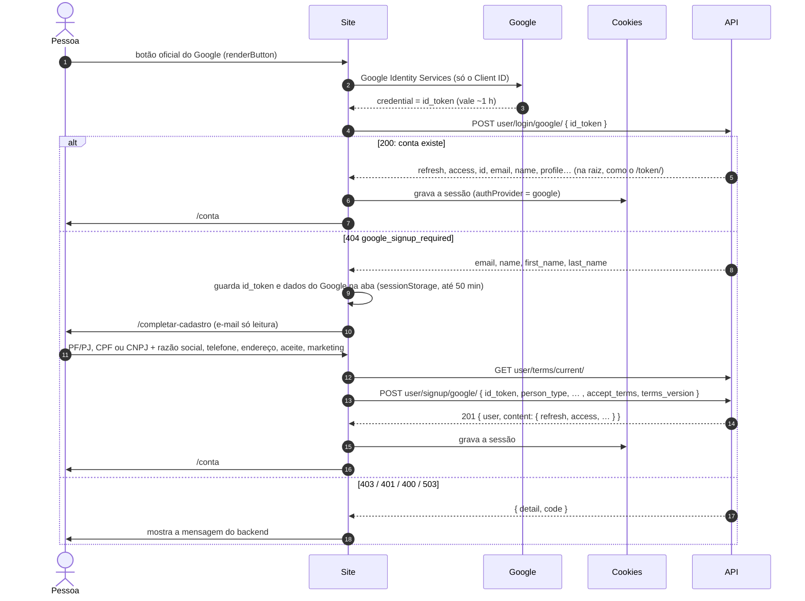

- **Erros do login:**
  - `google_link_not_allowed`: o e-mail já tem cadastro com senha, então a pessoa deve entrar com e-mail e senha;
  - `google_account_mismatch`;
  - `google_profile_not_allowed`;
  - `user_blocked` e `contract_expired`;
  - `google_token_invalid` e `google_email_not_verified`;
  - `google_not_configured` e `google_unavailable`.
  - Em todos, o site mostra o `detail` do backend.
- **Erros do cadastro (`signup/google`):**
  - erros de campo aparecem no campo certo;
  - `google_already_registered` volta para `/entrar`;
  - `google_token_invalid` e `google_email_not_verified` pedem o Google de novo;
  - nos três casos, o cadastro pendente é limpo.
- **Conta do Google não tem senha:** "Alterar senha" some em Meus dados. O "Esqueci a senha" dessa conta responde `google_account`, e o site mostra "Essa conta entra com outro método de autenticação.".
- **Chave do Google:** o site usa só o **Client ID** (`VITE_GOOGLE_CLIENT_ID`). O secret fica no backend.
- **Cliente HTTP:** `user/login/google/` e `user/signup/google/` estão fora do interceptor de 401, porque `user_blocked` também volta como 401.

### 4.6 Esqueci a senha

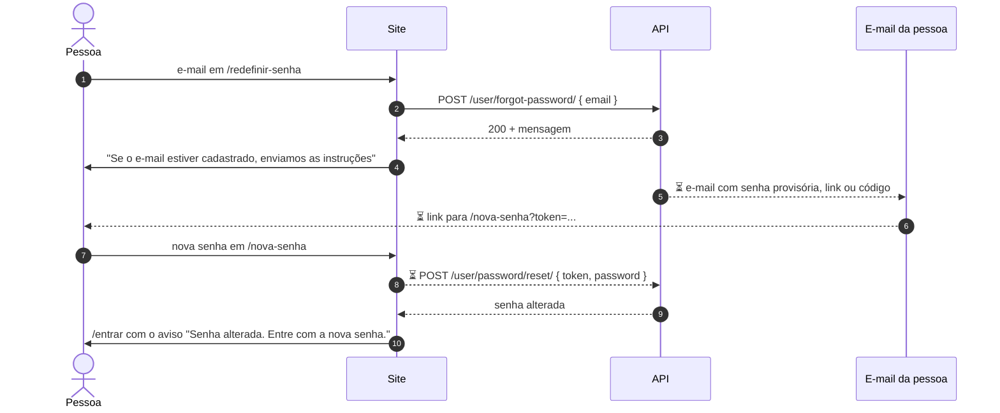

- **Tela `/nova-senha` (criada em 26/11/2026, só interface):** lê o `token` da URL. Sem `token`, mostra "Link inválido ou expirado" e o botão "Pedir novo link" (`/redefinir-senha`). Com `token`, pede a senha nova e a confirmação, com a mesma regra de senha do cadastro.
- ⏳ O backend ainda não tem essa rota. O site supõe `POST /user/password/reset/` com `{ token, password }`; quando o backend definir o contrato (nome do parâmetro na URL, rota e corpo), ajustar `resetPassword` em `auth.api.ts` e o `clientLoader` de `routes/_auth.nova-senha.tsx`.
- ⏳ Falta saber o que o e-mail traz. No Corp, o caminho é senha provisória + troca obrigatória no primeiro acesso, que **não vale para o perfil 4**.
- **Observado em 26/11/2026:** `POST /user/forgot-password/` com um e-mail sem conta responde `400` com `{ content: { message: "Opss.. Por favor tente novamente mais tarde!" } }`, e o site mostra essa mensagem como erro. A tela "Confira seu e-mail" só aparece com resposta de sucesso. Perguntar ao backend se e-mail desconhecido deve mesmo dar erro (isso revela quais e-mails têm conta).

### 4.7 Primeiro acesso de cliente migrado ⏳

Só se o backend aprovar (está na especificação como "se aprovada").

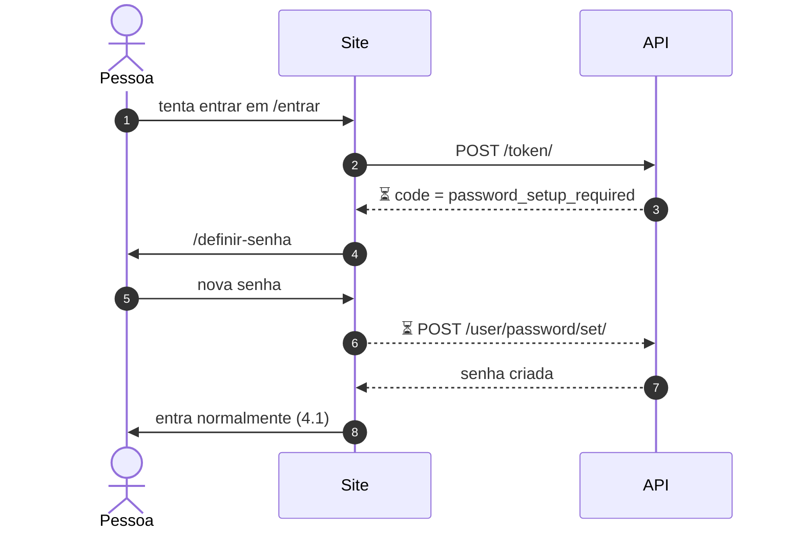

### 4.8 Estados da pessoa no site

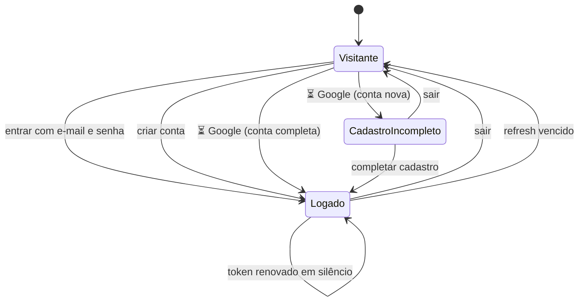

## 5. Corp × site

| Assunto            | Corp                                      | Site                                                           |
| ------------------ | ----------------------------------------- | -------------------------------------------------------------- |
| Quem usa           | equipe e empresas (perfis internos)       | cliente final (perfil 4)                                       |
| Sessão             | 3 cookies via JavaScript                  | 3 cookies via JavaScript (mesmo modelo)                        |
| Login              | e-mail e senha + reCAPTCHA v3/v2          | igual, mais Google ⏳                                          |
| Cadastro           | feito pela equipe (`user/signup/`, admin) | a própria pessoa (`/signup/`, público, com reCAPTCHA e aceite) |
| Primeiro acesso    | troca de senha obrigatória                | não se aplica; ⏳ "definir senha" para migrados                |
| Completar cadastro | não existe                                | ⏳ depois do Google                                            |
| Token vencido      | refresh automático; falhou → login        | igual                                                          |

## 6. Perguntas para o backend

1. **Google:** contrato recebido. Falta só testar de ponta a ponta quando o ambiente voltar.
2. **Cadastro incompleto:** resolvido pelo fluxo do Google (`google_signup_required` → `/completar-cadastro`). Não há `profile_complete`.
3. **`/signup/`:** quais campos são obrigatórios? Telefone e endereço podem ficar para depois? O `201` devolve tokens (para entrar direto) ou só o usuário?
4. **Esqueci a senha:** o e-mail manda senha provisória, link ou código? Se for link ou código, qual rota cria a senha nova? A tela `/nova-senha` já existe e supõe `?token=` e `POST /user/password/reset/ { token, password }`. E-mail sem conta deve responder erro (`400`, como hoje) ou sucesso genérico?
5. **Migrados:** o `password_setup_required` e o `POST /user/password/set/` vão existir? Qual o corpo? Hoje a rota responde `404`.
6. **Logout:** vai existir rota para invalidar o refresh (blacklist)?
7. **Cookies `HttpOnly` (futuro):** o backend pode passar a gravar o refresh num cookie `HttpOnly`? Hoje fica com o JavaScript, igual ao Corp.
8. **CORS:** liberar `http://localhost:3000` e os domínios de preview e produção do site. Em 26/11/2026 o `localhost:3000` está liberado; o domínio da Vercel não.

## 7. Arquitetura no código

O auth fica em `app/domains/auth`, em camadas. Cada camada só chama as de baixo. As regras de import são checadas pelo Biome.

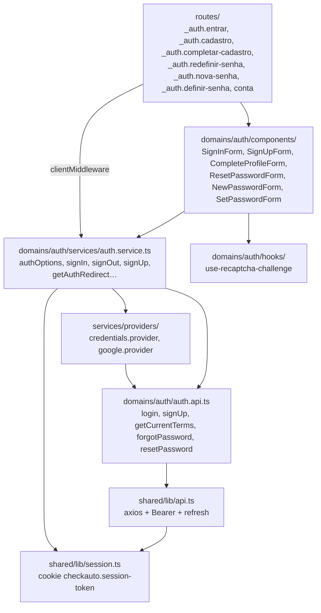

| next-auth                                             | aqui                                                    |
| ----------------------------------------------------- | ------------------------------------------------------- |
| `auth.ts` / `authOptions`                             | `domains/auth/services/auth.service.ts`                 |
| `providers/credentials`, `providers/google`           | `domains/auth/services/providers/*.provider.ts`         |
| `callbacks.session`, `pages.signIn` / `pages.newUser` | `authOptions.callbacks` / `authOptions.pages`           |
| cookie `next-auth.session-token`                      | `checkauto.session-token` (`__Secure-` em https)        |
| `useSession()` / `getSession()`                       | `shared/hooks/use-session.ts` / `shared/lib/session.ts` |
| `middleware.ts`                                       | `clientMiddleware` da rota + `getAuthRedirect`          |

**Decisões:**

- **`auth.api.ts` × `auth.service.ts`:** o `auth.api.ts` só fala HTTP (endpoint e validação da resposta). O `auth.service.ts` tem a regra: provider, reCAPTCHA, a sessão e para onde redirecionar.
- **Rotas de visitante e protegidas:** `/entrar` e `/cadastro` redirecionam quem já está logado na própria rota (`useSession` + `<Navigate>`), para continuar pré-renderizadas com o formulário. `/conta` e `/completar-cadastro` usam `clientMiddleware`, e o HTML pré-renderizado delas mostra só "Carregando…".
- **Cadastro pelo Google:** `/completar-cadastro` só abre com um cadastro do Google pendente na aba; sem ele, vai para `/entrar` (ou `/conta`, se já tiver sessão).
- **`/nova-senha`:** página pública que lê o `token` no `clientLoader` (a query string não existe no HTML pré-renderizado, que mostra só "Carregando…").
- **`authProvider` na sessão:** `credentials` ou `google`, para esconder "Alterar senha" de quem entra pelo Google.

## 8. Referências

- Corp: `src/shared/contexts/auth-context.tsx`, `src/shared/lib/api.ts`, `src/shared/lib/cookies.ts`, `src/features/auth/utils/must-change-password.ts`, `src/pages/Login/index.tsx`, `src/routes/index.tsx`.
- Swagger: `docs/api/openapi.json` (cópia de 26/11/2026, 139 rotas: entraram `user/login/google/` e `user/signup/google/`) e o resumo em `docs/api/README.md`.
- Especificação do cadastro: `docs/api/cadastro-aceite-contrato.md`.

## 9. O que já foi testado

Rodada de 26/11/2026, com o site em `localhost:3000` e o backend no túnel ngrok de desenvolvimento.

| Item                                                                    | Resultado                                              |
| ----------------------------------------------------------------------- | ------------------------------------------------------ |
| `/conta` sem sessão                                                     | ✅ vai para `/entrar`                                  |
| `/entrar` e `/cadastro` com sessão                                      | ✅ vão para `/conta/consultas`                         |
| `/completar-cadastro` sem cadastro do Google pendente                   | ✅ vai para `/entrar`                                  |
| Validação de `/entrar`, `/cadastro`, `/redefinir-senha` e `/nova-senha` | ✅ envio vazio mostra os erros e foca o primeiro campo |
| Contrato no cadastro                                                    | ✅ carrega a versão `2026-11` da API e abre no modal   |
| Botão do Google em `/entrar` e `/cadastro`                              | ✅ script e botão carregam                             |
| Corpo do `POST /signup/`                                                | ✅ teste automático (`auth.service.sign-up.test.ts`)   |
| `POST /user/forgot-password/` com e-mail sem conta                      | ⚠️ `400` com mensagem de erro (ver 4.6)                |
| `POST /user/password/set/`                                              | ❌ `404`                                               |

**Ainda sem teste de ponta a ponta** (dependem de senha, CPF, desafio do reCAPTCHA ou caixa de e-mail reais):

- cadastro com e-mail e senha, incluindo o desafio "não sou um robô";
- login com senha errada e certa, e sair;
- login e cadastro com Google, até o fim de `/completar-cadastro`;
- alterar senha em Meus dados;
- esqueci a senha com um e-mail que existe (o e-mail chega? o que ele traz?).
