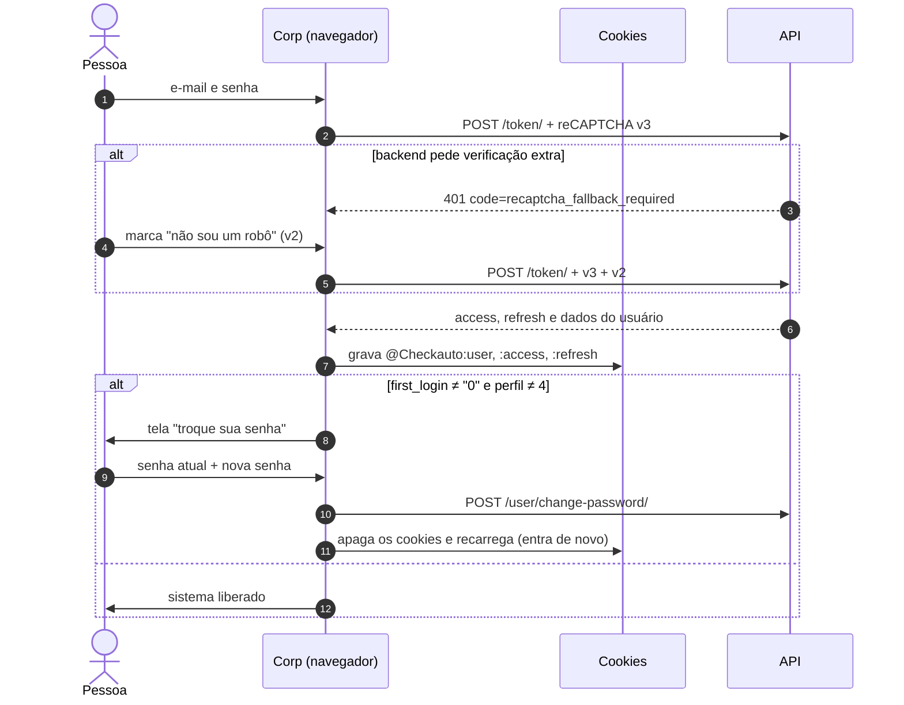
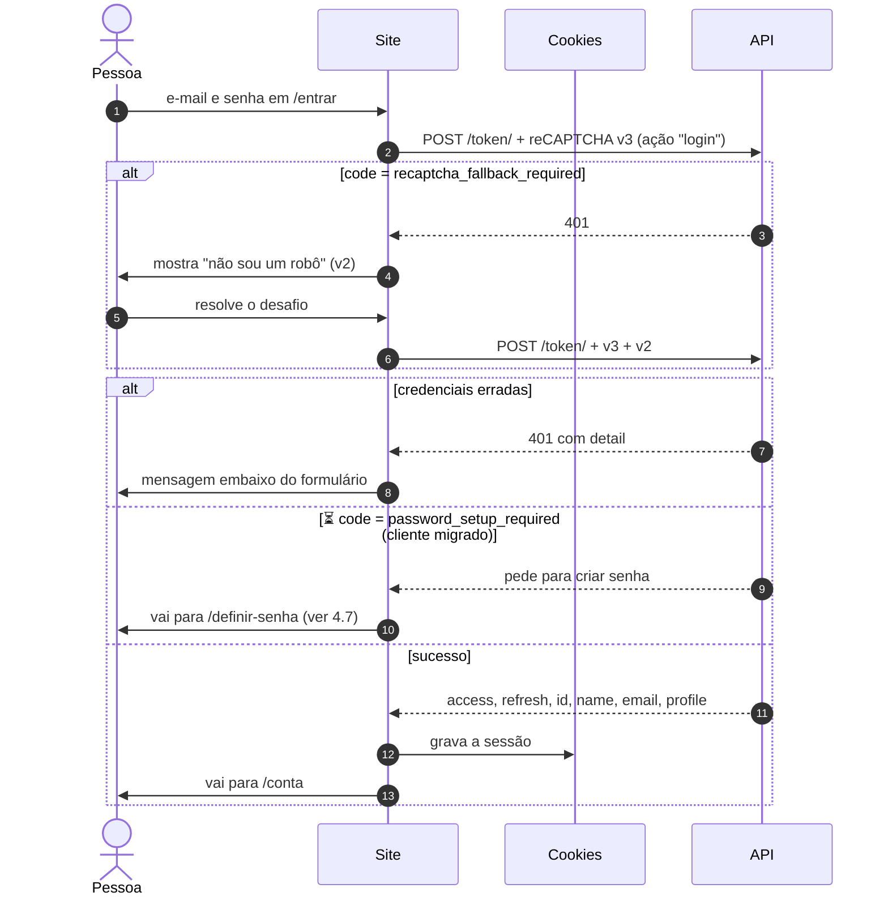
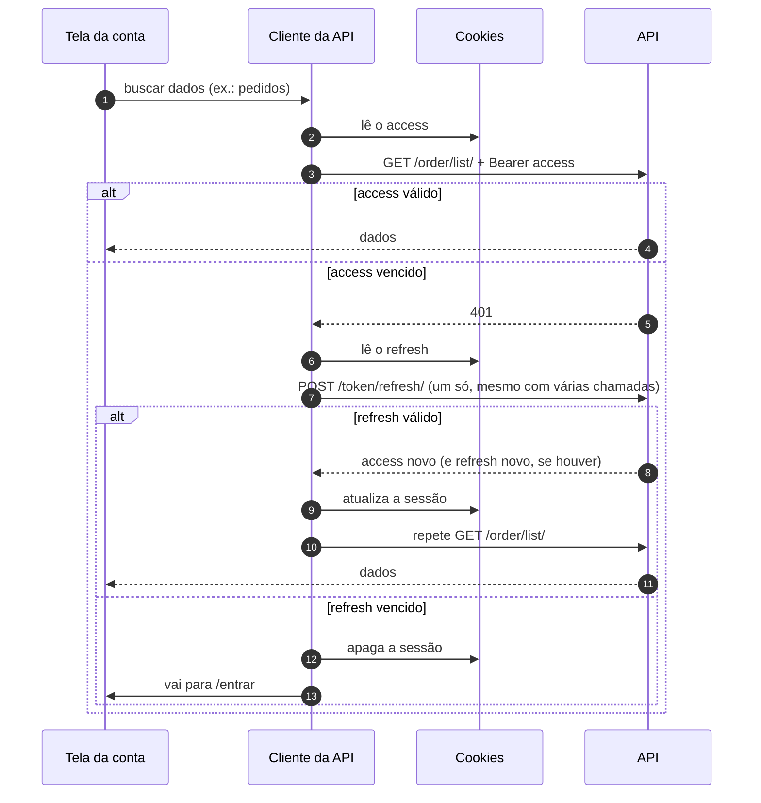
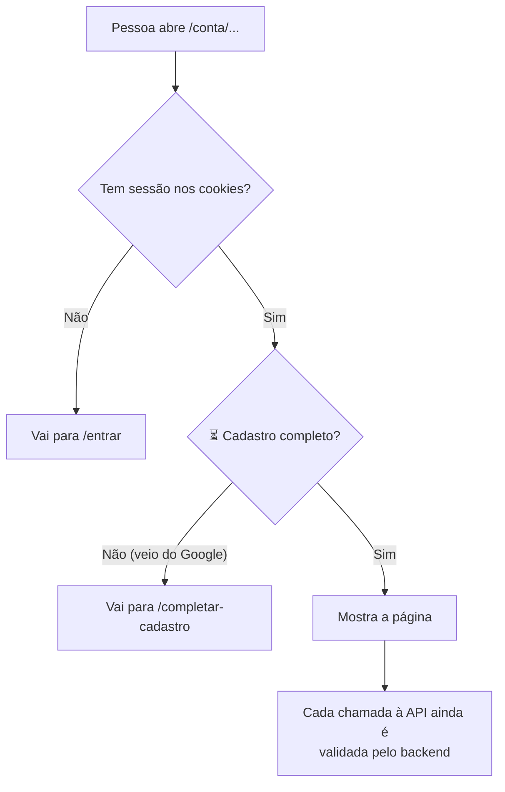
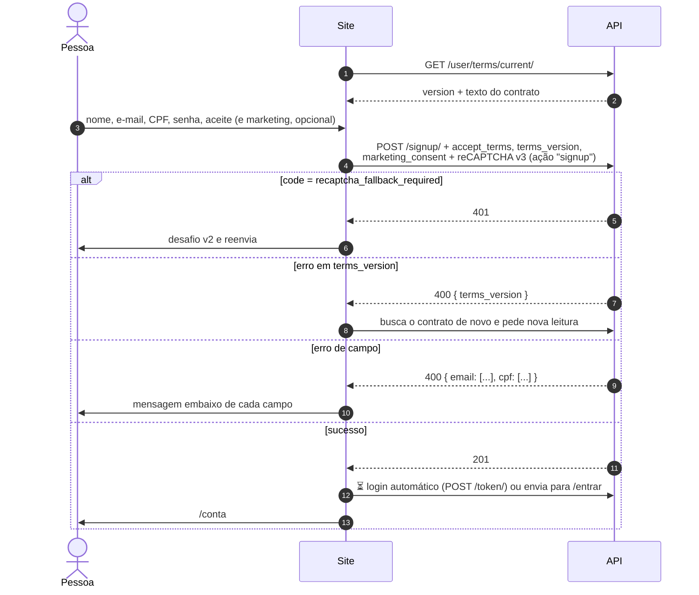
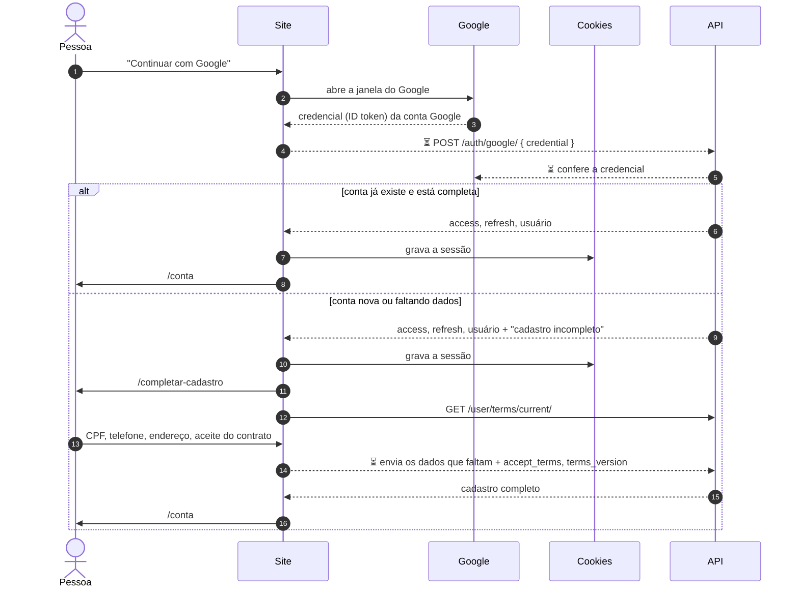
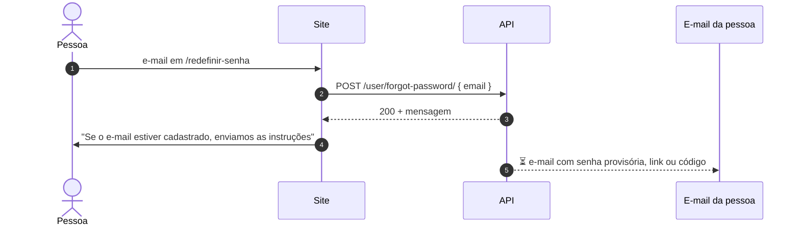
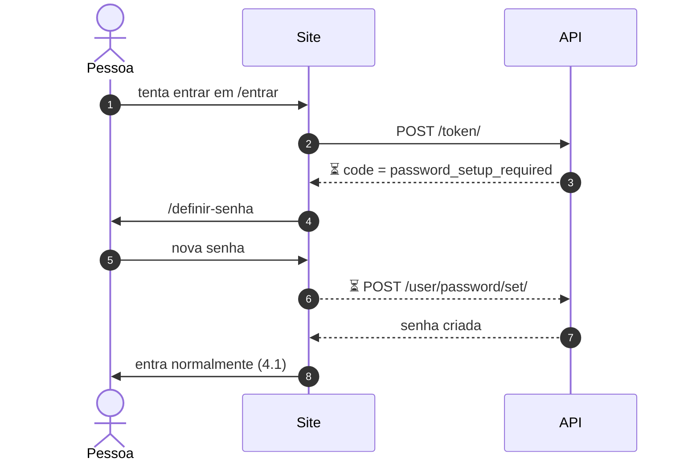
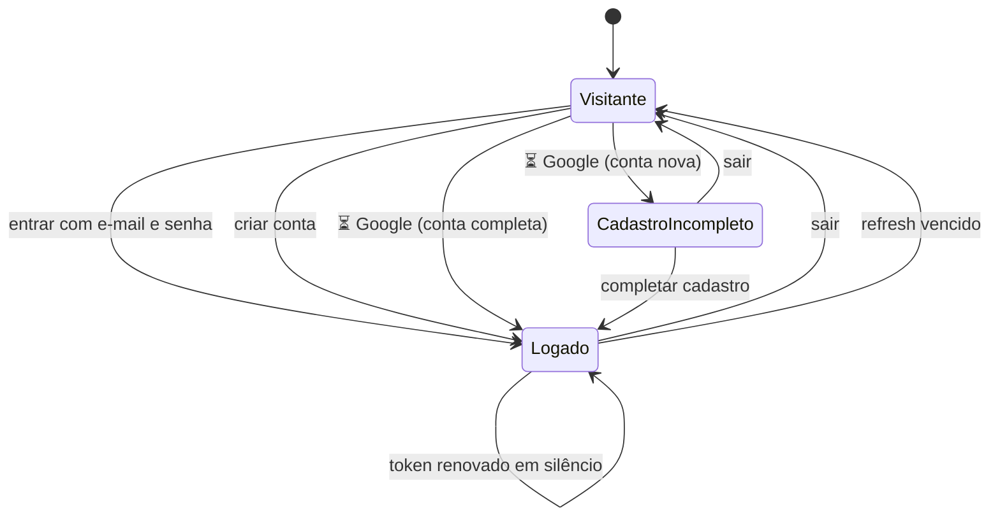

# Fluxo de autenticação

Como o login funciona hoje no **Checkauto Corp** e como vai funcionar no **site novo**: entrar com e-mail e senha, sessão em cookies, cadastro, login com Google, completar cadastro, esqueci a senha e primeiro acesso.

Os diagramas usam [Mermaid](https://mermaid.js.org/) e aparecem desenhados no GitHub e no VS Code (com a extensão de preview de Markdown com Mermaid).

**Legenda**

- ✅ confirmado pelo Swagger (`docs/api/openapi.json`) ou pela especificação do backend (`docs/api/cadastro-aceite-contrato.md`).
- ⏳ ainda depende do backend. Nos diagramas, as setas tracejadas (`-->>` com "⏳") são esses passos.

## 1. As peças

- **Site:** é estático (sem servidor próprio). Tudo acontece no navegador, que chama a API diretamente.
- **Cookies:** guardam a sessão (access token, refresh token e dados básicos do usuário). Como quem grava é o JavaScript do site, **não** são `HttpOnly`; o mesmo modelo do Corp.
- **API:** autentica por JWT. Toda rota protegida recebe `Authorization: Bearer <access>`.
- **Tokens:** o `access` abre as rotas protegidas; o `refresh` serve só para pedir um `access` novo quando ele vence.

## 2. Rotas de auth do backend

| Fluxo                       | Rota                                                                                     | Token? | Situação                               |
| --------------------------- | ---------------------------------------------------------------------------------------- | ------ | -------------------------------------- |
| Login                       | `POST /token/` (`username`, `password`, `recaptcha_token`, `recaptcha_token_v2`)         | não    | ✅                                     |
| Renovar sessão              | `POST /token/refresh/` (`refresh`)                                                       | não    | ✅                                     |
| Validar token               | `POST /token/verify/` (`token`)                                                          | não    | ✅ (não precisamos usar)               |
| Texto do contrato           | `GET /user/terms/current/`                                                               | não    | ✅                                     |
| Cadastro do site            | `POST /signup/`                                                                          | não    | ✅ rota; ⏳ corpo completo             |
| Esqueci a senha             | `POST /user/forgot-password/` (`email`)                                                  | não    | ✅ rota; ⏳ o que vem depois do e-mail |
| Trocar senha                | `POST /user/change-password/` (`current_password`, `new_password`, `new_password_again`) | sim    | ✅ (formato usado pelo Corp)           |
| Meus dados                  | `GET /user/retrieve/{id}/`, `PUT /user/update/{id}/`                                     | sim    | ✅                                     |
| Login com Google            | —                                                                                        | —      | ⏳ não existe no Swagger               |
| Completar cadastro (Google) | —                                                                                        | sim    | ⏳ não existe no Swagger               |
| Definir senha (migrados)    | `POST /user/password/set/`                                                               | —      | ⏳ só na especificação, "se aprovada"  |

Resposta do login (`POST /token/`): `access`, `refresh`, `id`, `name`, `email`, `profile`, `first_login`, `corporate_id`, `corporate_name`, `checkmatch`, `checkmatch_token`. Erros vêm como `{ "detail": "...", "code": "..." }`.

## 3. Como o Corp faz hoje

- **Sessão:** três cookies gravados pelo JavaScript (`universal-cookie`). A pessoa está "logada" se o cookie do usuário existe.
- **Chamadas:** um interceptor do axios põe `Authorization: Bearer <access>` em tudo.
- **Token vencido:** no `401`, faz **um** `POST /token/refresh/` (as outras chamadas esperam numa fila), regrava os cookies e repete a chamada. Se o refresh falha, apaga os cookies e volta ao login.
- **Primeiro acesso:** só para perfis internos. O **perfil 4 (cliente do site) não passa por isso**.
- **Esqueci a senha:** `POST /user/forgot-password/` com `{ email }`; o backend responde com uma mensagem e manda o e-mail.
- **Não existe** no Corp: cadastro público, login com Google, completar cadastro.

## 4. Como vai funcionar no site

### 4.1 Entrar com e-mail e senha

### 4.2 Sessão, chamadas e saída

- **Sair:** apaga os cookies e volta para a home. ⏳ Não há rota de logout no backend, então o refresh continua válido até vencer.
- **Várias abas:** todas leem os mesmos cookies; sair numa aba vale para as outras na próxima ação.
- **Header do site:** com sessão, mostra o avatar (link para a conta); sem sessão, o botão "Entrar".

### 4.3 Proteção da área da conta

A proteção no navegador só decide **qual tela mostrar**. Quem protege os dados de verdade é o backend, que exige o token em cada rota.

### 4.4 Criar conta (e-mail e senha)

- Cadastro **não** manda `Authorization`, mesmo com sessão aberta.
- ⏳ Falta o backend confirmar os campos obrigatórios do `/signup/`. O Corp, no `user/signup/`, manda também `person_type`, telefone e endereço.

### 4.5 Entrar com Google e completar o cadastro ⏳

Nada disso existe no backend ainda. Este é o desenho proposto para levar ao backend.

- O Google traz **nome, e-mail e foto**. Falta **CPF (ou CNPJ), telefone e endereço**, além do **aceite do contrato**, que é obrigatório também nessa via.
- Cadastro pelo Google **não usa reCAPTCHA** (está na especificação).
- **Enquanto o cadastro estiver incompleto**, a área da conta manda para `/completar-cadastro` (ver 4.3).
- **Chave do Google:** num site estático, só o **Client ID** pode ficar no navegador. O **Client Secret nunca** vai para o site. Por isso o desenho usa o "ID token" do Google, que o backend valida sozinho. Se o backend preferir o fluxo com `code` + secret, a troca do código tem que acontecer no backend.

### 4.6 Esqueci a senha

⏳ Falta saber o que o e-mail traz. Se for link ou código, o site precisa de uma tela para criar a senha nova, e o backend de uma rota para isso.

### 4.7 Primeiro acesso de cliente migrado ⏳

Só se o backend aprovar (está na especificação como "se aprovada").

### 4.8 Estados da pessoa no site

## 5. Corp × site

| Assunto            | Corp                                      | Site                                                           |
| ------------------ | ----------------------------------------- | -------------------------------------------------------------- |
| Quem usa           | equipe e empresas (perfis internos)       | cliente final (perfil 4)                                       |
| Sessão             | 3 cookies via JavaScript                  | 3 cookies via JavaScript (mesmo modelo)                        |
| Login              | e-mail e senha + reCAPTCHA v3/v2          | igual, mais Google ⏳                                          |
| Cadastro           | feito pela equipe (`user/signup/`, admin) | a própria pessoa (`/signup/`, público, com reCAPTCHA e aceite) |
| Primeiro acesso    | troca de senha obrigatória                | não se aplica; ⏳ "definir senha" para migrados                |
| Completar cadastro | não existe                                | ⏳ depois do Google                                            |
| Token vencido      | refresh automático; falhou → login        | igual                                                          |

## 6. Perguntas para o backend

1. **Google:** qual rota recebe a credencial do Google? O backend aceita o **ID token** (só Client ID no site) ou quer o `code`? O que volta quando a conta é nova?
2. **Cadastro incompleto:** como o backend avisa que faltam dados (um campo no login, como `profile_complete`, ou um `code`)? Qual rota salva o complemento e quais campos são obrigatórios para PF e PJ?
3. **`/signup/`:** quais campos são obrigatórios? Telefone e endereço podem ficar para depois? O `201` devolve tokens (para entrar direto) ou só o usuário?
4. **Esqueci a senha:** o e-mail manda senha provisória, link ou código? Se for link ou código, qual rota cria a senha nova?
5. **Migrados:** o `password_setup_required` e o `POST /user/password/set/` vão existir? Qual o corpo?
6. **Logout:** vai existir rota para invalidar o refresh (blacklist)?
7. **Cookies `HttpOnly` (futuro):** o backend pode passar a gravar o refresh num cookie `HttpOnly`? Hoje fica com o JavaScript, igual ao Corp.
8. **CORS:** liberar `http://localhost:3000` e os domínios de preview e produção do site.

## 7. Referências

- Corp: `src/shared/contexts/auth-context.tsx`, `src/shared/lib/api.ts`, `src/shared/lib/cookies.ts`, `src/features/auth/utils/must-change-password.ts`, `src/pages/Login/index.tsx`, `src/routes/index.tsx`.
- Swagger: `docs/api/openapi.json` (conferido com a API publicada em 25/11/2026: mesmas 137 rotas) e o resumo em `docs/api/README.md`.
- Especificação do cadastro: `docs/api/cadastro-aceite-contrato.md`.
